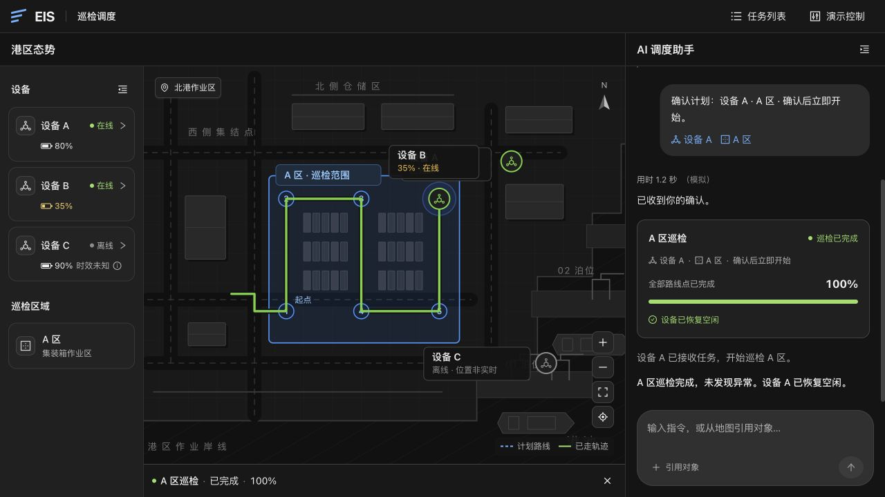

# 黄颖君 - AI设计工程师 - 实操题

**EIS 对话与态势地图协同**

面向港区调度人员的桌面交互演示，聚焦“查看设备 → 安排巡检 → 确认执行 → 结果反馈”。

## 1. 打开与运行

[直接在线体验](https://yingjun2301.github.io/eis-patrol-demo/)，无需安装或解压，建议窗口宽度不小于 1280px。

源码位于 `source/`。使用 Node.js 22.12+，依次执行 `cd source`、`npm ci`、`npm run dev`；`npm test` 运行测试，`npm run build` 重新构建。

## 2. 约 3 分钟体验

1. 点击“创建巡检任务”，选择 A 区及“在线且电量 > 50%”，检查可用设备。
2. 查看 A 符合、B 电量不足、C 离线的原因。点击卡片中的设备名定位地图；在左栏“加入对话”后输入“查看状态”，体验反向引用。
3. 回到计划卡，选择“确认后立即开始”，再点“修改计划”切换巡检顺序；保存后观察地图路线同步变化，此时仍未执行。
4. 点击“确认计划”，观察地图轨迹与任务进度；可暂停、继续，也可输入“查看设备 B 电量”，体验独立问答。
5. 正常执行约 20 秒达到 100%。同一条任务回复持续更新，进展和完成报告依次追加在卡片下方。

**异常体验：**重新演示，在确认前开启“模拟一次路线准备失败”；失败后点击“重新准备路线”，按原确认继续。预约任务可用“推进到预约时间”加速体验。

## 3. 设计亮点

- **统一的深色视觉体系**  
  基于 Ant Design，通过 Token 统一色彩、字号、间距、圆角与浮层层次；精简图标、状态标记和重复说明，让地图、任务与关键操作更突出。

- **地图与助手协同的工作空间**  
  对象列表与地图组成统一态势区，右侧助手承载对话与任务操作，底栏持续显示当前进展。通过对象定位与对话引用，连接空间信息和调度意图。

- **连贯的任务创建与执行体验**  
  通过条件选择和时间澄清形成计划，在原卡片内完成预览、修改与确认；执行后在同一条任务回复中持续更新进展与结果，独立问答分别呈现，异常可直接重试。

## 4. 个人主导与 AI 协作

我负责设计判断与多轮运行效果走查，集中推动以下调整：

| 阶段 | 主导调整 |
|---|---|
| 初始定界 | 区分题目事实与场景假设，明确数据时效、确认边界及可运行交付 |
| 第一轮 | 精简导航、设备列表与任务简报，建立黑灰视觉及 Token 规范 |
| 第二轮 | 原卡修改计划、按阶段精简任务卡，整理对象引用和消息流 |
| 第三轮 | 合并态势工作区，明确可选筛选条件，补齐暂停、停止与异常恢复 |

收尾走查集中修正文案、控件比例、浮层层次和完成汇报顺序。Codex 辅助实现代码、编写和运行测试、执行浏览器验证及整理文档。

## 5. 验证与范围

Codex 已运行 42 项逻辑测试，生产构建通过；此前已走查筛选、双向引用、修改同步及执行流程。本轮在 1280 × 720 下复查连续任务回复、独立问答、暂停／继续、失败重试及停止，地图、卡片与状态栏保持一致。

设备、AI 回复、路线和执行均为模拟，未接真实 AI、地图服务或设备接口。刷新会重置状态，预约需保持页面打开；“任务列表”仅展示入口。未实现多任务、后台调度、手机适配及完整跨浏览器验证。
